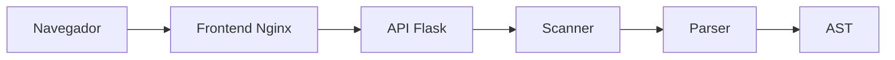

# Laboratório de Linguagens

## Trabalho 1 — Primeira etapa do projeto

Este repositório apresenta a primeira etapa do meu software educacional: um ambiente inicial para estudar como uma linguagem de programação é analisada. Nesta fase, o objetivo principal não é entregar um analisador completo, e sim construir uma base organizada, reproduzível e preparada para receber as próximas funcionalidades.

## 1\. Escolha da linguagem e do subconjunto inicial

Para o projeto, escolhi a linguagem **Python** como linguagem de programação a ser analisada nas próximas etapas. A escolha foi feita porque Python tem uma sintaxe relativamente simples e bastante legível, o que facilita a explicação dos conceitos de análise léxica, sintática e semântica. Além disso, é uma linguagem muito utilizada tanto no ensino quanto no mercado, tornando o projeto mais próximo de situações reais de aprendizagem.

O subconjunto inicial planejado será pequeno e progressivo. Primeiro, serão trabalhados:

* declaração e atribuição de variáveis;
* tipos básicos, como números, textos e valores booleanos;
* operadores aritméticos e relacionais;
* estruturas condicionais (`if` e `else`);
* comandos simples de saída, como `print()`.

Decidi começar dessa forma porque tentar analisar toda a linguagem Python logo no início deixaria o projeto muito amplo e difícil de validar. Com um subconjunto bem delimitado, será possível implementar cada etapa com mais cuidado e explicar os resultados de maneira compreensível para quem está aprendendo.

## 2\. Estrutura do repositório

```text
trabalho-1/
├── backend/
│   ├── app.py
│   ├── requirements.txt
│   └── Dockerfile
├── frontend/
│   ├── app.js
│   ├── index.html
│   ├── nginx.conf
│   ├── styles.css
│   └── Dockerfile
├── docker-compose.yml
└── README.md
```

O **frontend** é responsável pela interface que o usuário acessa. O **backend** disponibiliza as rotas da aplicação e, nesta primeira versão, responde à mensagem de teste e a uma rota de saúde. A separação entre as duas partes foi feita desde o começo para deixar o projeto mais organizado e facilitar sua evolução.

## 3\. Tecnologias utilizadas

* Python 3.12;
* Flask, para a criação do backend;
* HTML, CSS e JavaScript, para a interface;
* Nginx, para servir o frontend e encaminhar as chamadas da API;
* Docker e Docker Compose, para padronizar o ambiente.

Não incluí banco de dados nesta etapa porque ainda não existe uma funcionalidade que precise armazenar informações. Essa decisão evita complexidade desnecessária e mantém o foco na estrutura inicial do sistema.

## 4\. Como executar o projeto

### Pré-requisitos

É necessário ter instalado:

* Docker 24 ou superior;
* Docker Compose v2 ou superior, normalmente disponível pelo comando `docker compose`;
* Git, caso o repositório seja clonado do GitHub.

### Inicialização

Na pasta raiz do projeto, execute:

```bash
docker compose up --build
```

Depois, abra no navegador:

```text
http://localhost:8080
```

Ao acessar http://localhost:8080, a aplicação apresenta a interface do Laboratório de Linguagens, com editor de código Python, exemplos e botão para solicitar análise. A comunicação entre frontend e backend pode ser verificada pela rota /api/hello, que retorna a mensagem “Hello, World!”, e pela rota /api/analyze, responsável por receber e validar o código-fonte enviado.

### Encerramento

Para parar os serviços sem remover os contêineres, use `Ctrl + C`. Para derrubar os contêineres criados pelo Compose, execute:

```bash
docker compose down
```

Se for necessário reconstruir as imagens depois de alguma alteração, use novamente:

```bash
docker compose up --build
```

## 5\. Rotas disponíveis no backend

* `GET /api/hello`: retorna a mensagem de teste da aplicação;
* `GET /api/health`: informa se o backend está funcionando corretamente.

## 6\. Validação da instalação limpa

A validação deve ser feita em uma máquina ou ambiente que não tenha dependências específicas deste projeto instaladas. O procedimento é:

1. clonar o repositório;
2. entrar na pasta do projeto;
3. executar `docker compose up --build`;
4. acessar `http://localhost:8080`;
5. confirmar a exibição de “Hello, World!”;
6. executar `docker compose down` ao finalizar.

A configuração foi preparada para que não seja necessário instalar Flask, Nginx ou outras dependências diretamente na máquina do usuário. Essas dependências são instaladas e executadas dentro dos contêineres, o que torna o processo mais previsível.

## 7\. Repositório e acompanhamento

O projeto deve ser publicado em um repositório do GitHub e compartilhado com o professor **rocha3runo**, conforme a orientação da disciplina. Depois da publicação, o link do repositório deve ser informado no local indicado pelo professor.

## Considerações finais

Esta primeira etapa representa a fundação do projeto. Mesmo que a aplicação ainda seja simples, ela já possui uma divisão clara entre frontend e backend, uma configuração reproduzível com Docker e uma documentação que explica como começar e como encerrar a execução. A partir dessa base, as próximas etapas poderão se concentrar na implementação do analisador educacional, sem que seja necessário reorganizar toda a estrutura do sistema.


# Trabalho 2 — Interface Web e entrada de código-fonte

## O que foi acrescentado

Nesta segunda etapa, a tela inicial foi transformada em uma interface de entrada para o analisador educacional. O usuário consegue escrever ou colar um programa em Python, editar o conteúdo, escolher um exemplo pronto e solicitar o recebimento do código pelo backend.

A proposta continua sendo trabalhar inicialmente com variáveis, tipos básicos, operadores aritméticos e estruturas condicionais. A análise léxica, sintática e semântica ainda não é executada: neste momento, o sistema valida a entrada, registra algumas informações simples e deixa o código preparado para as próximas etapas.

## Exemplos disponíveis

A interface oferece três exemplos:

1. **Variáveis e tipos básicos** — apresenta atribuições de texto, número e valor booleano.
2. **Operações aritméticas** — apresenta soma, multiplicação e armazenamento de um resultado.
3. **Estrutura condicional** — apresenta `if`, `else` e uma decisão baseada em uma nota.

Ao escolher um exemplo, seu conteúdo é carregado no editor, mas continua totalmente editável. Assim, o estudante pode observar o código, modificar alguma parte e só depois solicitar o processamento.

## Comunicação entre frontend e backend

O frontend envia o código para o backend por meio de uma requisição HTTP `POST` para `/api/analyze`, usando JSON:

```json
{
  "codigo": "numero = 10\\\\nprint(numero)"
}
```

Em caso de sucesso, o backend responde com:

```json
{
  "success": true,
  "message": "Código recebido com sucesso. A análise será implementada nas próximas etapas.",
  "recebido": true,
  "estatisticas": {
    "caracteres": 25,
    "linhas": 2
  }
}
```

A API também trata entrada ausente, corpo que não seja JSON e código vazio. O frontend repete a validação antes do envio para dar uma resposta mais rápida, mas o backend mantém sua própria validação para não depender apenas da interface.

## Mensagens para o usuário

As mensagens foram separadas por situação: aviso para código vazio ou inválido, sucesso para código recebido e erro de comunicação quando o servidor não pode ser acessado. As mensagens não exibem caminhos internos, rastreamentos ou informações técnicas desnecessárias para o estudante.

## Testes automatizados

Os testes podem ser executados na raiz do projeto com:

```bash
python3 -m unittest discover -s backend -p "test\_\*.py"
node --test frontend/test\_app\_core.js
```

O registro detalhado dos testes está em [`docs-testes-trabalho-2.md`](docs-testes-trabalho-2.md). Os testes cobrem o novo endpoint, os casos inválidos, os caracteres especiais, os exemplos e a regressão das rotas que já existiam na primeira etapa.


# Trabalho 3 — Análise Léxica (Scanner)

## Escopo léxico do subconjunto Python

A terceira etapa implementa um scanner didático próprio em `backend/scanner.py`. Ele percorre o código caractere a caractere, cria tokens com tipo, lexema, linha e coluna, ignora espaços e comentários e acumula erros sem interromper a análise.

| Categoria | Suporte e exemplos |
|---|---|
| Palavras reservadas | `and`, `else`, `False`, `if`, `in`, `is`, `None`, `not`, `or`, `print`, `return`, `True`, `while` |
| Identificadores | Letra ou `_` seguida de letras, dígitos ou `_`; exemplos: `nome`, `resultado`, `_valor1` |
| Literais inteiros | Uma ou mais casas decimais; exemplos: `0`, `10`, `42` |
| Literais reais | Parte inteira, ponto e parte decimal; exemplos: `3.14`, `8.5` |
| Literais de texto | Delimitados por aspas simples ou duplas, com escapes; exemplos: `'oi'`, `"Olá\\n"` |
| Operadores | `+`, `-`, `*`, `/`, `//`, `%`, `**`, `=`, `==`, `!=`, `<`, `>`, `<=`, `>=`, `+=`, `-=`, `*=`, `/=`, `%=`, `//=`, `**=` |
| Delimitadores | `(`, `)`, `[`, `]`, `{`, `}`, `.`, `,`, `:`, `;` |
| Comentários | Comentários de linha iniciados por `#`; são ignorados |
| Espaços em branco | Espaços, tabulações, retornos de carro e quebras de linha são ignorados; a quebra atualiza linha e coluna |
| Caracteres não reconhecidos | Geram `ERRO_LEXICO` com lexema, linha, coluna e mensagem didática; a análise continua |

A linguagem escolhida continua sendo Python, mas o scanner cobre apenas o subconjunto documentado acima. Indentação ainda não é tokenizada, e a análise sintática e semântica serão desenvolvidas nas Etapas 4 e 5.

## Implementação do scanner

O scanner foi implementado em Python, usando uma classe `Scanner` com cursor, linha e coluna atuais. A identificação usa a estratégia de maior correspondência para operadores compostos: por exemplo, `==` é reconhecido antes de dois operadores `=`. Strings não fechadas e números no formato incompleto `12.` geram erros localizados. Um erro não encerra o processamento; tokens válidos posteriores continuam sendo retornados.

A escolha de um scanner próprio, em vez de delegar a tokenização ao módulo `tokenize` da biblioteca padrão, mantém cada decisão visível para fins educacionais e permite mostrar mensagens consistentes com o subconjunto definido. A interface web exibe a sequência resultante, as contagens por categoria e as mensagens de erro.

## Contrato atualizado da API

A rota `POST /api/analyze` recebe:

```json
{
  "codigo": "numero = 10\nprint(numero)"
}
```

Em uma análise sem erros, retorna HTTP 200:

```json
{
  "success": true,
  "sucesso": true,
  "message": "Análise léxica concluída: todos os lexemas foram reconhecidos.",
  "recebido": true,
  "estatisticas": {"caracteres": 25, "linhas": 2},
  "tokens": [
    {"tipo": "IDENTIFICADOR", "lexema": "numero", "linha": 1, "coluna": 1},
    {"tipo": "OPERADOR", "lexema": "=", "linha": 1, "coluna": 8},
    {"tipo": "LITERAL_INTEIRO", "lexema": "10", "linha": 1, "coluna": 10}
  ],
  "erros": []
}
```

Quando há erro léxico, a análise também termina com HTTP 200, pois o processamento foi concluído, mas `success` e `sucesso` assumem `false`:

```json
{
  "success": false,
  "sucesso": false,
  "tokens": [],
  "erros": [
    {
      "tipo": "ERRO_LEXICO",
      "lexema": "@",
      "linha": 1,
      "coluna": 9,
      "mensagem": "Erro léxico na linha 1, coluna 9: Caractere não reconhecido '@'. Verifique se o trecho faz parte do subconjunto suportado."
    }
  ]
}
```

O contrato anterior foi preservado para não quebrar a interface existente: `success`, `message`, `recebido` e `estatisticas` continuam presentes. Entrada vazia permanece rejeitada com HTTP 422, e requisições malformadas continuam recebendo HTTP 400.

## Como executar e testar

Com dependências locais:

```bash
python3 -m unittest discover -s backend -p "test_*.py" -v
node --test frontend/test_app_core.js
python3 -m unittest discover -s frontend -p "test_*.py" -v
python3 -m py_compile backend/app.py backend/scanner.py backend/test_app.py backend/test_scanner.py
```

Com Docker Compose:

```bash
docker compose up --build -d
docker compose ps
curl http://localhost:8080/api/health
curl -X POST http://localhost:8080/api/analyze \
  -H 'Content-Type: application/json' \
  -d '{"codigo":"numero = 10"}'
docker compose down
```

## Limitações conhecidas e próximos passos

Esta etapa ainda não constrói árvore sintática, não verifica indentação, não valida a gramática, não monta tabela de símbolos e não avalia tipos. Esses comportamentos pertencem às etapas seguintes. O scanner também não cobre toda a especificação Python, incluindo números científicos, strings multilinha, f-strings, decorators, operadores de bit e indentação significativa.

O diferencial didático desta versão é mostrar o percurso mínimo entre código, token, lexema e posição, além de continuar a análise depois de encontrar um erro. Na Etapa 4, o parser poderá consumir diretamente a lista de tokens retornada por este contrato.

# Trabalho 4 — Análise Sintática e AST

## 1. Objetivo

Nesta etapa, o Laboratório de Linguagens passou a realizar
a análise sintática de um subconjunto da linguagem Python,
utilizando os tokens produzidos pelo scanner da Etapa 3.

O objetivo é permitir que o estudante compreenda como
um compilador reconhece os elementos de um programa,
verifica sua organização gramatical e representa sua
estrutura por meio de uma Árvore Sintática Abstrata (AST).

## 2. Funcionalidades implementadas

- Análise léxica com reconhecimento de tokens e lexemas;
- Análise sintática descendente recursiva;
- Gramática formal documentada em EBNF;
- Construção e serialização da AST;
- Precedência e associatividade de operadores;
- Atribuições e expressões;
- Literais inteiros, reais, textuais, booleanos e nulos;
- Chamadas de print com zero ou mais argumentos;
- Estruturas condicionais if e else;
- Condicionais aninhados;
- Verificação da indentação;
- Diagnósticos léxicos e sintáticos separados;
- Posições iniciais e finais dos nós da AST;
- Árvore hierárquica com controles de expansão;
- Apresentação de regras gramaticais;
- Limites de entrada e complexidade;
- Testes automatizados e de integração.

## 3. Arquitetura

O projeto mantém a separação entre frontend e backend.

O frontend utiliza HTML, CSS e JavaScript, sendo
disponibilizado pelo servidor Nginx.

O backend utiliza Python e Flask e contém os módulos
responsáveis pela análise léxica e sintática.

Os serviços são executados com Docker Compose.



O parser somente é executado quando não existem
erros léxicos.

## 4. Organização dos principais arquivos

```text
software-educacional-compiladores/
  backend/
    app.py
    scanner.py
    parser.py
    syntax_ast.py
    requirements.txt
    Dockerfile
    test_app.py
    test_scanner.py
    test_parser.py
    test_robustez.py
  frontend/
    index.html
    styles.css
    app.js
    app-core.js
    nginx.conf
    Dockerfile
    test_app_core.js
    test_interface.py
  docs/
    gramatica.md
    fluxograma.md
  evidencias/
    etapa-4/
  docker-compose.yml
  docs-testes-trabalho-4.md
  ENTREGA.md
  README.md
```

A estrutura acima apresenta os principais arquivos,
sem listar todos os arquivos de testes e documentos
das etapas anteriores.

## 5. Gramática e estratégia do parser

O analisador sintático foi implementado manualmente
utilizando análise descendente recursiva e escalonamento
de precedência para as expressões.

O símbolo inicial da gramática é programa.

A indentação é identificada pelas posições dos tokens,
sem a emissão de tokens específicos INDENT e DEDENT.

A documentação completa está disponível em:

- [Gramática formal](docs/gramatica.md)
- [Fluxograma do software](docs/fluxograma.md)

## 6. Precedência dos operadores

| Prioridade | Operadores |
|---|---|
| Maior | ** |
| 5 | *, /, //, % |
| 4 | +, - |
| 3 | ==, !=, <, >, <=, >= |
| 2 | and |
| Menor | or |

A potência é associativa à direita. Os operadores
aritméticos restantes e os operadores lógicos são
associativos à esquerda.

Comparações encadeadas não são suportadas.

## 7. Árvore Sintática Abstrata

Cada nó da AST contém:

- tipo;
- linha;
- coluna;
- atributos;
- filhos;
- linhaFinal, quando disponível;
- colunaFinal, quando disponível.

Exemplo de entrada:

```python
resultado = 10 + 5 * 2
print(resultado)
```

Representação simplificada:

```text
PROGRAMA
  ATRIBUICAO: resultado
    OPERACAO_BINARIA: +
      LITERAL_INTEIRO: 10
      OPERACAO_BINARIA: *
        LITERAL_INTEIRO: 5
        LITERAL_INTEIRO: 2
  CHAMADA_FUNCAO: print
    IDENTIFICADOR: resultado
```

A estrutura demonstra que a multiplicação possui
precedência superior à adição.

A AST representa a organização do programa, mas
não executa nem calcula o resultado das expressões.

## 8. Interface educacional

A interface disponibiliza cinco exemplos editáveis:

1. Variáveis e tipos básicos;
2. Operações aritméticas;
3. Estrutura condicional;
4. Exemplo com erro léxico;
5. Exemplo com erro sintático.

Após solicitar uma análise, o estudante pode
visualizar os tokens, seus tipos, lexemas e posições.

Quando o código é sintaticamente válido, a AST
é apresentada de maneira hierárquica, com posições
dos nós e regras gramaticais das operações.

A interface diferencia visualmente três resultados:

- Verde: análise léxica e sintática bem-sucedida;
- Amarelo: ocorrência de erro léxico;
- Vermelho: ocorrência de erro sintático.

## 9. Contrato da API

Rotas disponíveis:

| Método | Rota | Finalidade |
|---|---|---|
| GET | /api/hello | Verificação inicial da API |
| GET | /api/health | Verificação de saúde |
| POST | /api/analyze | Análise do código-fonte |

Exemplo de requisição:

```json
{
  "codigo": "resultado = 10 + 5 * 2"
}
```

A resposta preserva os campos das etapas anteriores
e acrescenta informações da análise sintática.

Principais campos:

| Campo | Finalidade |
|---|---|
| success e sucesso | Resultado geral da análise |
| message | Mensagem explicativa |
| recebido | Indicação de recebimento |
| estatisticas | Quantidade de caracteres e linhas |
| tokens | Tokens reconhecidos |
| erros | Erros léxicos |
| lexico | Resultado da análise léxica |
| sintatico | Resultado da análise sintática |
| ast | Árvore Sintática Abstrata |
| erros_sintaticos | Diagnósticos sintáticos |

Quando existem erros léxicos, o parser não é executado.

Quando existem erros sintáticos, a AST final é nula.

Erros encontrados durante a análise são retornados
com HTTP 200, pois a requisição foi processada.

Entradas malformadas, vazias ou acima dos limites
recebem os códigos HTTP apropriados, incluindo
400, 422 e 413.

## 10. Como executar a versão atual

Pré-requisitos:

- Docker;
- Docker Compose;
- Git, para clonar o repositório.

Na raiz do projeto, execute:

```bash
docker compose up --build -d
```

Verifique os serviços:

```bash
docker compose ps
```

Acesse no navegador:

http://localhost:8080

Para encerrar:

```bash
docker compose down
```

Não é necessário instalar Flask ou Nginx diretamente
na máquina para executar a aplicação com Docker.

## 11. Como executar os testes automatizados

Para executar os testes localmente, são necessários
Python, Node.js e as dependências do backend.

```powershell
python -m pip install -r backend\requirements.txt

python -m unittest discover -s backend -p "test*.py" -v

node --test frontend\test_app_core.js

python frontend\test_interface.py -v
```

## 12. Resultados da validação

| Categoria | Testes aprovados |
|---|---:|
| Backend, scanner, parser, gramática e robustez | 71 |
| Lógica JavaScript | 10 |
| Contrato estático da interface | 12 |
| Total automatizado | 93 |
| Integração HTTP | 5 |

A execução no Docker e a comunicação entre frontend
e backend também foram verificadas.

As evidências visuais demonstram a análise aritmética,
a estrutura condicional, a AST e a apresentação de
erros léxicos e sintáticos.

Documentação complementar:

- [Registro detalhado dos testes](docs-testes-trabalho-4.md)
- [Evidências da Etapa 4](evidencias/etapa-4/)
- [Documento de entrega](ENTREGA.md)

## 13. Limites de processamento

| Recurso | Limite |
|---|---:|
| Caracteres do código | 10000 |
| Corpo da requisição HTTP | 128 KiB |
| Tokens | 2000 |
| Profundidade de parênteses | 100 |
| Profundidade da AST | 100 níveis |

Os limites foram definidos para reduzir problemas
de processamento excessivo e preservar a utilização
educacional da aplicação.

## 14. Limitações e próximas etapas

O software não implementa toda a linguagem Python.

Ainda não são suportados:

- Declaração de funções e return;
- Laços for e while;
- Operadores unários;
- Comparações encadeadas;
- Expressões em múltiplas linhas;
- Listas e dicionários;
- Classes e importações;
- Análise semântica;
- Verificação de tipos;
- Tabela de símbolos;
- Execução do código-fonte.

A integração opcional com Ollama não foi implementada.
O funcionamento do analisador não depende de serviços
externos de inteligência artificial.

A próxima etapa será dedicada à análise semântica,
utilizando a AST produzida nesta versão.

Os testes realizados verificam o funcionamento técnico
do software. Ainda não foi realizada uma avaliação
formal de aprendizagem com estudantes.
