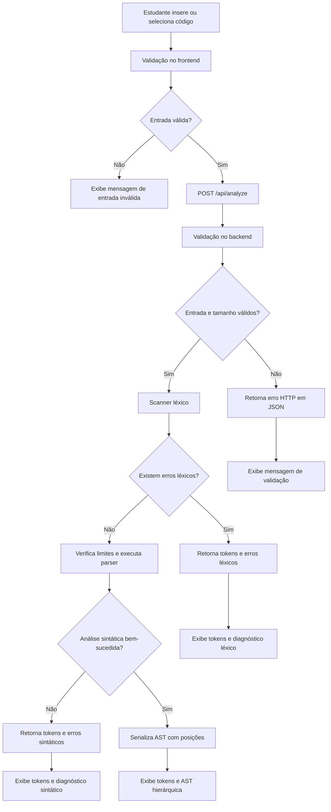
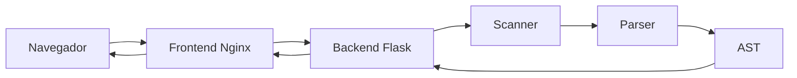

# Fluxograma do software educacional

## Fluxo de processamento — Etapa 4

## Descrição

O frontend recebe o código-fonte, valida a entrada e
envia uma requisição HTTP ao backend.

O backend verifica novamente a entrada e os limites
de processamento.

O scanner identifica os tokens e registra os erros
léxicos. Caso existam erros léxicos, o parser não
é executado.

Na ausência de erros léxicos, os tokens são encaminhados
ao parser, que verifica as construções gramaticais
e constrói a Árvore Sintática Abstrata.

Quando existem erros sintáticos, a aplicação apresenta
os tokens e os diagnósticos, sem disponibilizar a AST.

Quando a análise é bem-sucedida, a interface apresenta
a tabela de tokens e a AST hierárquica, com posições,
regras gramaticais e controles de expansão e recolhimento.

## Arquitetura

O frontend e o backend são executados em contêineres
gerenciados pelo Docker Compose.

O processamento é determinístico e independente de
serviços externos de inteligência artificial.

A análise semântica será incorporada na Etapa 5.
